<p align="center">
  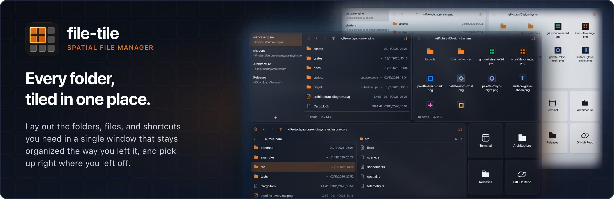
</p>

<p align="center">
  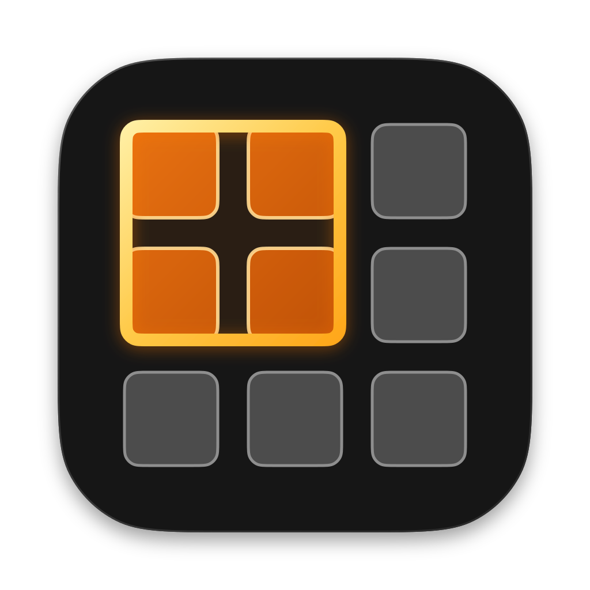
</p>

<h1 align="center">file-tile</h1>

<p align="center">
  <b>file-tile</b> is a file manager built for working across multiple folders at once. Lay out the folders, files, and shortcuts you need in a single window that stays organized the way you left it. Switch between projects in one click and always pick up right where you left off.
</p>

## Features

| Preview | Feature |
| :---: | :--- |
| 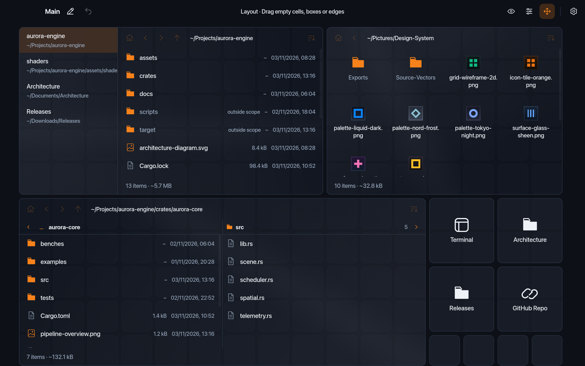 | **Spatial 2D Grid and Workspaces**<br><br>Draw, move, swap, and resize folder boxes and compact shortcut tiles on a 2D grid. Organize layouts into separate named workspaces and undo layout edits with a single shortcut. |
| 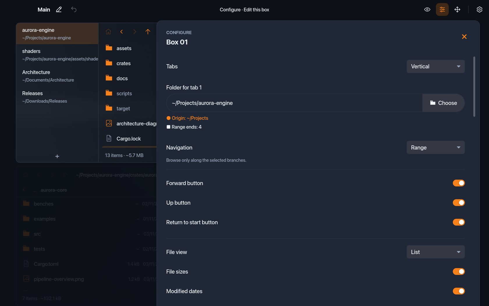 | **Navigation Scopes and Vertical Tabs**<br><br>Keep each box focused where it belongs. Browse freely (`Free`), lock a box to one folder (`Pinned`), stay within a folder subtree (`Branch`), or set custom start and stop boundaries (`Range`). Open multiple folders in one box with vertical tabs. |
| 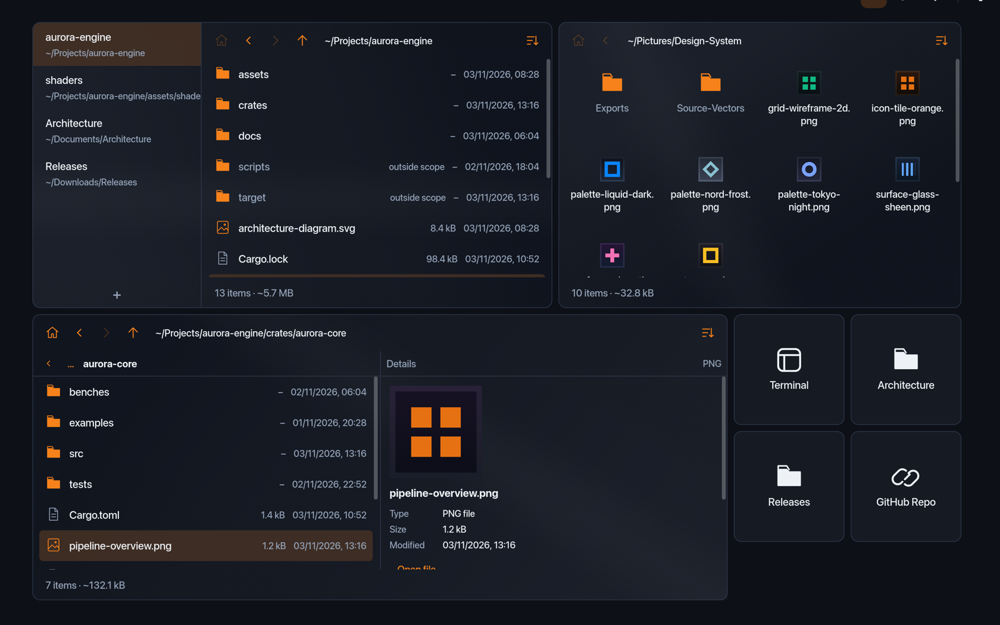 | **List, Grid, and Columns Views**<br><br>Choose the right view for each box. Inspect file sizes, modified dates, and folder usage in List view, browse image thumbnails in Grid view, or step through folder trees side by side in Columns view. Type to jump directly to matching files inside an active box or across every open box at once. |
| 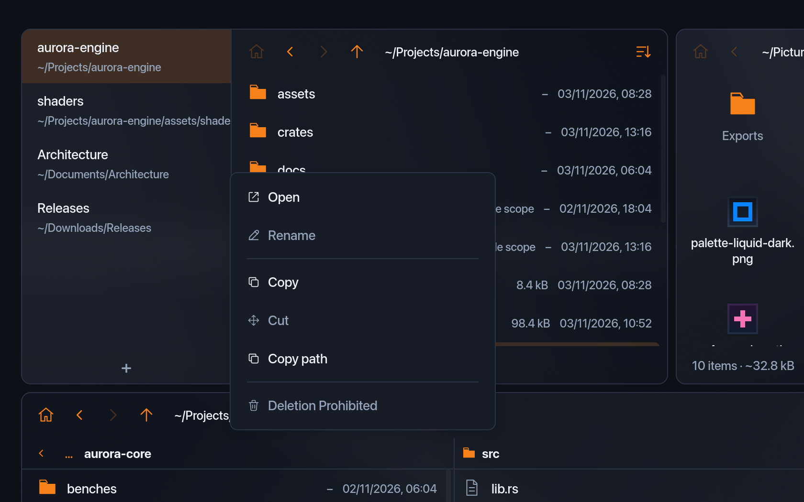 | **Native File Actions and Drag-and-Drop**<br><br>Copy, paste, move, rename, create files and folders, and move items to Trash. Drag files between boxes, or drag directly to and from external applications. |
| 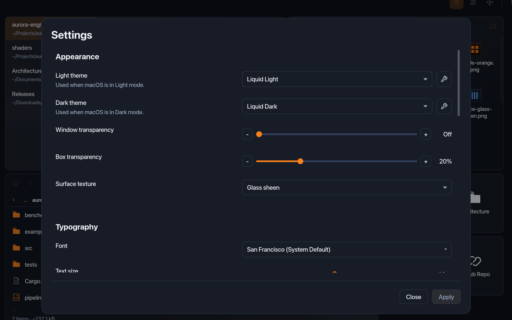 | **Themes, Transparency, and Typography**<br><br>Match your desktop with automatic Light and Dark themes, translucent `Liquid` surfaces, box surface textures, custom color themes, and bundled or installed system fonts. |
| 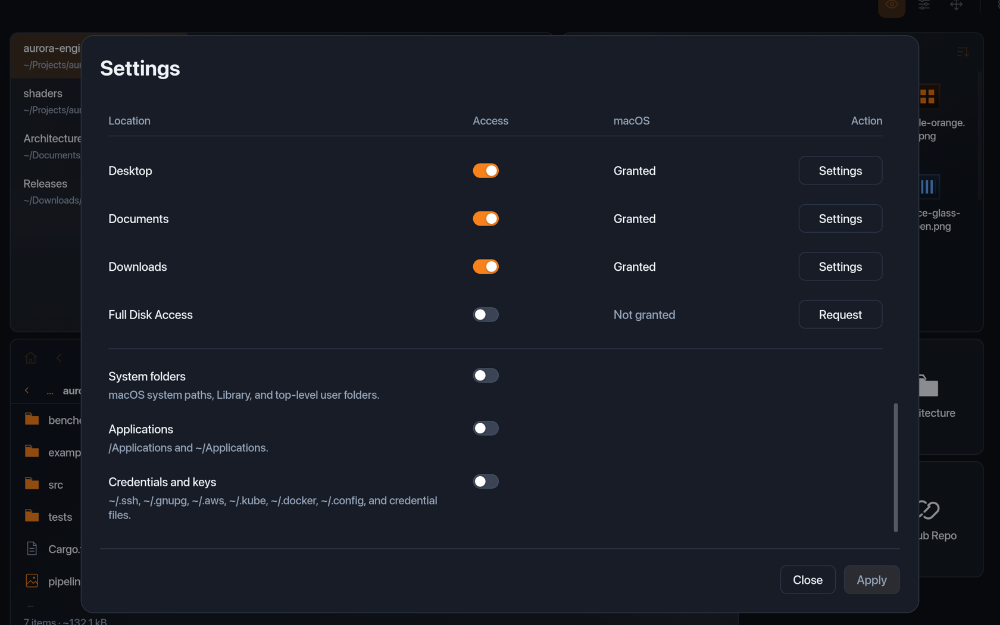 | **Access and Safety Controls**<br><br>Manage folder permissions (`Desktop`, `Documents`, `Downloads`, `Full Disk Access`) in one place. Block accidental edits in system folders, `/Applications`, and credential directories (`~/.ssh`, `~/.gnupg`, `~/.aws`), or disable deletion per box. |

<p align="center">
  <a href="assets/readme/gallery-1-liquid-dark.png">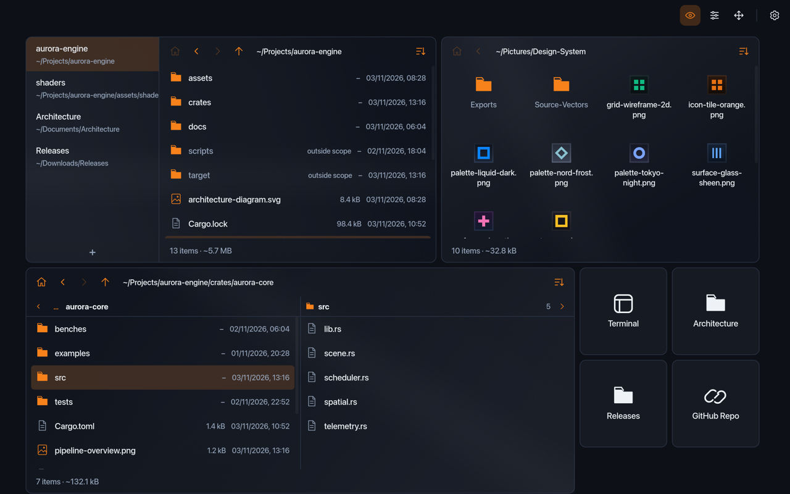</a>
  <a href="assets/readme/gallery-2-tokyo-night.png">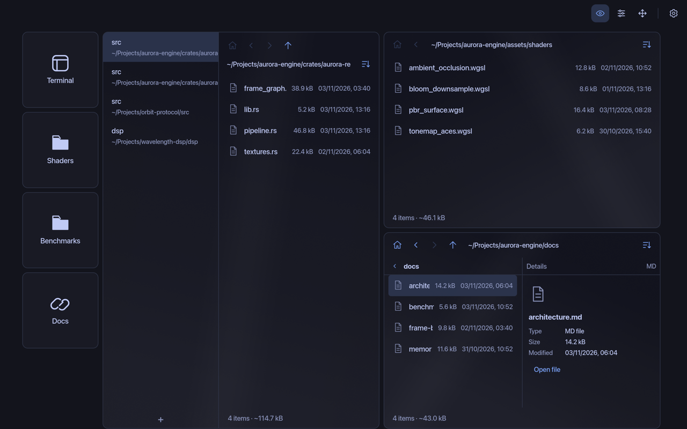</a>
  <a href="assets/readme/gallery-3-liquid-light.png">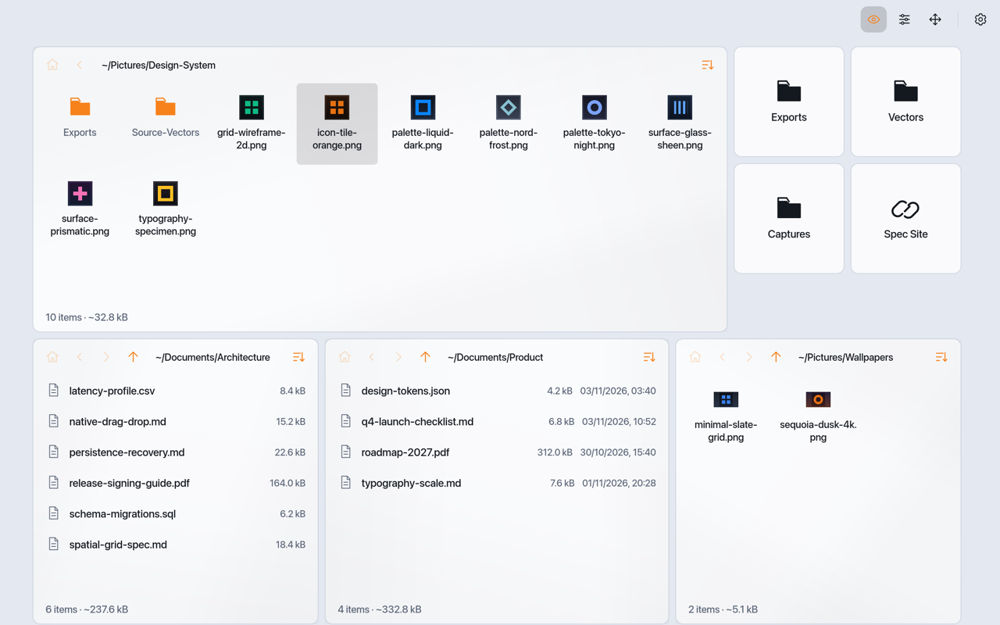</a>
  <a href="assets/readme/gallery-4-nord.png">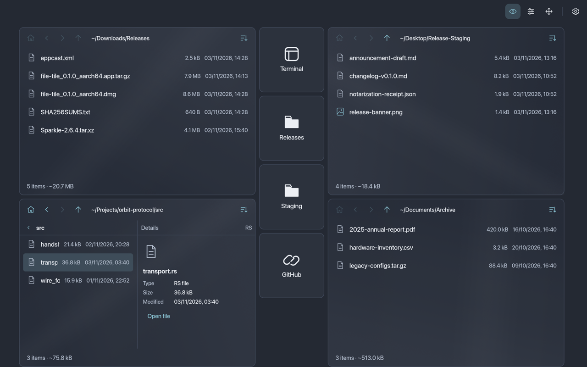</a>
  <a href="assets/readme/gallery-5-catppuccin-latte.png">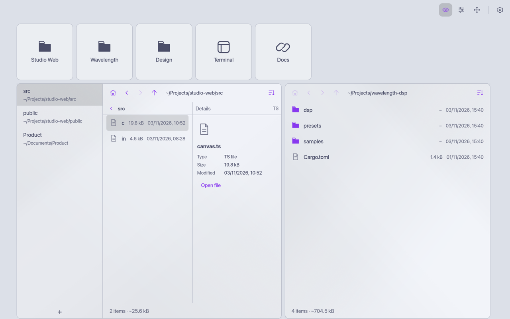</a>
</p>

## Requirements

- **macOS:** macOS 15.0 (Sequoia) or newer on Apple Silicon (`arm64`)
- **Linux:** Planned for a future release
- **Windows:** Planned for a future release

## Install

1. Download the latest `file-tile_<version>_aarch64.dmg` from [GitHub Releases](https://github.com/MRKups/file-tile/releases).
2. Open the `.dmg` file and drag `file-tile.app` into `/Applications`.
3. Open `file-tile` from `/Applications` or Spotlight. Packaged builds include [Sparkle 2](https://sparkle-project.org) for signed in-app update checks.

<br>

---

<br>

## Build from Source

### Prerequisites

- [Rustup](https://rustup.rs) (uses the toolchain in [rust-toolchain.toml](rust-toolchain.toml))
- Python 3.11 or newer
- [Task](https://taskfile.dev) (optional task runner)
- `cargo-packager` (required only to build `.app` and `.dmg` bundles):
  ```sh
  cargo install cargo-packager --version 0.11.8 --locked
  ```

### Build and Run with Task

```sh
task check     # Run documentation checks, source guards, Clippy, and tests
task run       # Run file-tile in debug mode
task build     # Build the release binary at target/release/file-tile
task package   # Build target/release/file-tile.app and the .dmg installer
```

### Build and Run without Task

```sh
python3 scripts/dev.py docs
python3 scripts/dev.py guard
cargo clippy --locked --workspace --all-targets -- -D warnings
cargo test --locked --workspace
cargo run --locked
python3 scripts/build.py release
CI=true cargo packager --release
```

## Local Data

`file-tile` writes application data to `~/Library/Application Support/file-tile/`:

- `config/preferences.json`: saved window bounds, appearance, typography, safety, and capability settings.
- `config/workspaces.json`: ordered workspace index and workspace names.
- `config/workspace-<uuid>.json`: saved boxes, shortcut tiles, tabs, and navigation history for each workspace.
- `config/user-themes.json`: custom user themes (created when you save a custom theme).
- `logs/file-tile.log`: rotating diagnostic log (excludes browsed paths, filenames, and file contents).

### Command-Line Options

- `--directory <path>`: set the starting folder for new boxes in the current session.
- `--state-dir <path>`: store configuration and logs in `<path>` instead of `~/Library/Application Support/file-tile/`.

## Contributing and Security

- Read [CONTRIBUTING.md](CONTRIBUTING.md) before you open an issue or pull request.
- Read [SECURITY.md](SECURITY.md) to report a security vulnerability privately through GitHub Security Advisories.

## License

MIT License. See [LICENSE](LICENSE). Bundled font licenses (`SIL OFL 1.1`) and third-party crate licenses are in [LICENSES/](LICENSES/).
